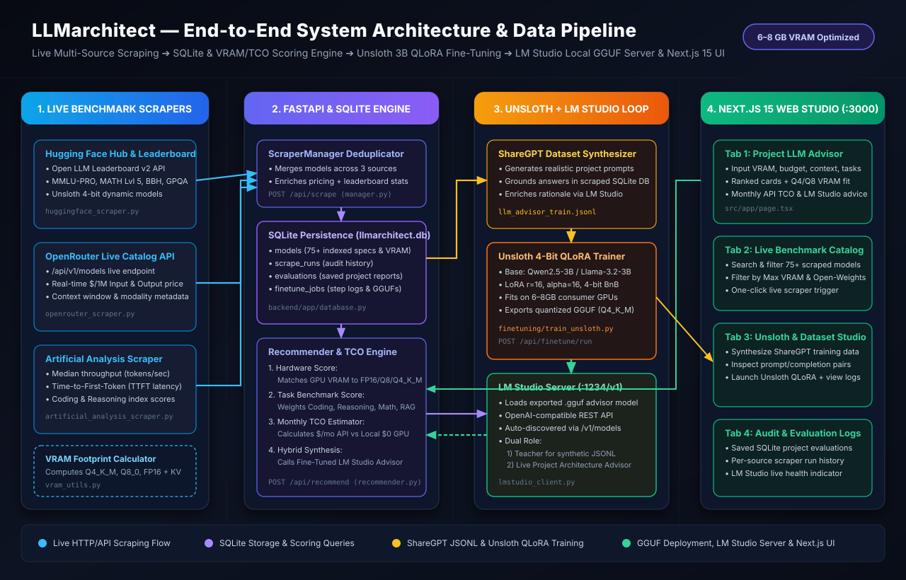

# LLMarchitect

An end-to-end production system that **recommends the optimal Large Language Model (LLM)** for any software project by:
1. **Live Scraping LLM benchmarks, throughput, latency, and pricing** from **Hugging Face Open LLM Leaderboards**, **OpenRouter Live Catalog API**, and **Artificial Analysis**.
2. **Persisting & indexing models in SQLite (`llmarchitect.db`)** with automatic GPU VRAM footprint calculations (**Q4_K_M**, **Q8_0**, **FP16** + KV-cache) and **Monthly TCO (Total Cost of Ownership)** estimation.
3. **Generating ShareGPT fine-tuning datasets** combining scraped benchmarks with **LM Studio** local teacher synthesis.
4. **Fine-tuning a 3B Low-VRAM model (`Qwen-2.5-3B` or `Llama-3.2-3B`) with Unsloth QLoRA** (fits on 6–8GB VRAM GPUs) and exporting to **GGUF (`Q4_K_M`)** for **LM Studio** inference.
5. **Serving a 4-Tab Next.js 15 + FastAPI Studio** to match project constraints (VRAM, budget, context length, coding/reasoning/math tasks) to the right model.



---

## Project Architecture

```text
LLMarchitect/
├── docs/
│   └── workflow-architecture.svg          # Full SVG system & dataflow architecture diagram
├── backend/                               # FastAPI Backend + Scrapers + SQLite + Recommender
│   ├── app/
│   │   ├── api/routes.py                  # REST endpoints (/api/recommend, /api/scrape, /api/finetune/run)
│   │   ├── database.py                    # SQLite persistence (models, scrape_runs, evaluations, finetune_jobs)
│   │   ├── models/schemas.py              # Pydantic schemas for specs, VRAM, TCO, and jobs
│   │   ├── scrapers/                      # Hugging Face, OpenRouter Live, Artificial Analysis & VRAM utils
│   │   └── services/                      # Recommender, LM Studio client, Dataset generator, Finetune manager
│   ├── data/
│   │   ├── llmarchitect.db                # Production SQLite database (75+ scraped models)
│   │   └── models_catalog.json            # Exported JSON catalog snapshot
│   ├── tests/test_pipeline.py             # Automated pytest suite
│   └── requirements.txt
├── finetuning/                            # Unsloth 3B QLoRA Fine-Tuning & GGUF Export Pipeline
│   ├── configs/qlora_3b_config.json       # Hyperparameters for Qwen-2.5-3B & Llama-3.2-3B
│   ├── datasets/llm_advisor_train.jsonl   # ShareGPT multi-turn fine-tuning dataset
│   ├── train_unsloth.py                   # Unsloth SFTTrainer + save_pretrained_gguf for LM Studio
│   └── requirements-unsloth.txt
└── frontend/                              # Next.js 15 + React + Tailwind CSS Web UI
    ├── public/workflow-architecture.svg   # Publicly served workflow diagram
    ├── src/app/page.tsx                   # 4-Tab Studio (Advisor, Catalog, Unsloth/Dataset, Audit Logs)
    └── src/lib/api.ts                     # Typed API client
```

---

## Professional Step-by-Step Guide

### Phase 1: Start the Backend & Scrape Live Benchmarks
1. **Create virtual environment & install dependencies** (already configured in `.venv`):
   ```powershell
   python -m venv .venv
   .\.venv\Scripts\pip install -r backend\requirements.txt
   ```
2. **Run automated test suite**:
   ```powershell
   $env:PYTHONPATH="backend"
   .\.venv\Scripts\pytest backend\tests\test_pipeline.py -v
   ```
3. **Launch the FastAPI Server (`http://localhost:8000`)**:
   ```powershell
   $env:PYTHONPATH="backend"
   .\.venv\Scripts\uvicorn app.main:app --host 127.0.0.1 --port 8000 --reload
   ```
4. **Trigger a Live Multi-Source Scrape**:
   ```powershell
   Invoke-RestMethod -Method Post -Uri "http://127.0.0.1:8000/api/scrape"
   ```
   - This scrapes **Hugging Face Leaderboards**, **OpenRouter Live API**, and **Artificial Analysis**, calculates `Q4_K_M`, `Q8_0`, and `FP16` VRAM footprints via `backend/app/scrapers/vram_utils.py`, and stores everything in `backend/data/llmarchitect.db`.

---

### Phase 2: Start the Next.js 15 Web Studio
1. **Install packages & build production bundle**:
   ```powershell
   cd frontend
   npm install
   npm run build
   ```
2. **Start the Web Server (`http://localhost:3000`)**:
   ```powershell
   npm run start -- -p 3000
   # Or for development hot-reload: npm run dev
   ```

---

### Phase 3: Connect LM Studio for Synthetic Dataset Generation
1. Open **[LM Studio](https://lmstudio.ai/)** and download an instruct model (e.g. `Qwen2.5-3B-Instruct-GGUF` or `Llama-3.2-3B-Instruct-GGUF`).
2. Open the **Developer / Local Server** tab in LM Studio:
   - Load the model into GPU memory.
   - Start the HTTP server on port **`1234`** (`http://localhost:1234/v1`).
3. Generate **ShareGPT Fine-Tuning Conversations** grounded in your scraped SQLite catalog:
   - Via UI: Open `http://localhost:3000` -> **Tab 3 (Unsloth 3B & LM Studio Studio)** -> Set samples to `50`–`100` -> Click **Generate ShareGPT Training Pairs**.
   - Via CLI:
     ```powershell
     Invoke-RestMethod -Method Post -Uri "http://127.0.0.1:8000/api/dataset/generate" -ContentType "application/json" -Body '{"num_samples": 60, "use_lmstudio": true}'
     ```
   - Output is saved to `finetuning/datasets/llm_advisor_train.jsonl`.

---

### Phase 4: Fine-Tune 3B Model with Unsloth QLoRA & Export GGUF
1. **Prepare a Python 3.11 + CUDA Environment** (Unsloth & PyTorch CUDA wheels require Python 3.10–3.12 and an NVIDIA GPU with 6–8GB+ VRAM, or a Google Colab T4 instance):
   ```powershell
   py -3.11 -m venv .venv-unsloth
   .\.venv-unsloth\Scripts\pip install -r finetuning\requirements-unsloth.txt
   .\.venv-unsloth\Scripts\pip install "unsloth[colab-new] @ git+https://github.com/unslothai/unsloth.git"
   ```
2. **Verify Configuration & Dataset (Dry-Run)**:
   ```powershell
   python finetuning\train_unsloth.py --base-model qwen-2.5-3b --dry-run
   ```
3. **Run QLoRA Fine-Tuning + Automatic `Q4_K_M` GGUF Export**:
   ```powershell
   .\.venv-unsloth\Scripts\python finetuning\train_unsloth.py --base-model qwen-2.5-3b --max-steps 60 --export-gguf
   ```
   - Saves LoRA adapters to `finetuning/outputs/lora_adapter/`.
   - Exports quantized GGUF model to `finetuning/outputs/llm_architect_gguf/`.

---

### Phase 5: Serve Your Fine-Tuned Advisor in LM Studio
1. In **LM Studio**, import the exported `.gguf` file from `finetuning/outputs/llm_architect_gguf/`.
2. Load it in the **Local Server (`localhost:1234/v1`)**.
3. In the **LLMarchitect Web UI (`http://localhost:3000`)**, ensure **"Query Fine-Tuned Model in LM Studio"** is checked in **Tab 1**.
4. Every project recommendation now combines:
   - Deterministic **SQLite multi-metric scoring** (VRAM fit, MMLU/Coding/Reasoning/Math benchmarks, Monthly API TCO).
   - Custom **architectural justification** generated by your fine-tuned **LLMarchitect 3B model**.
